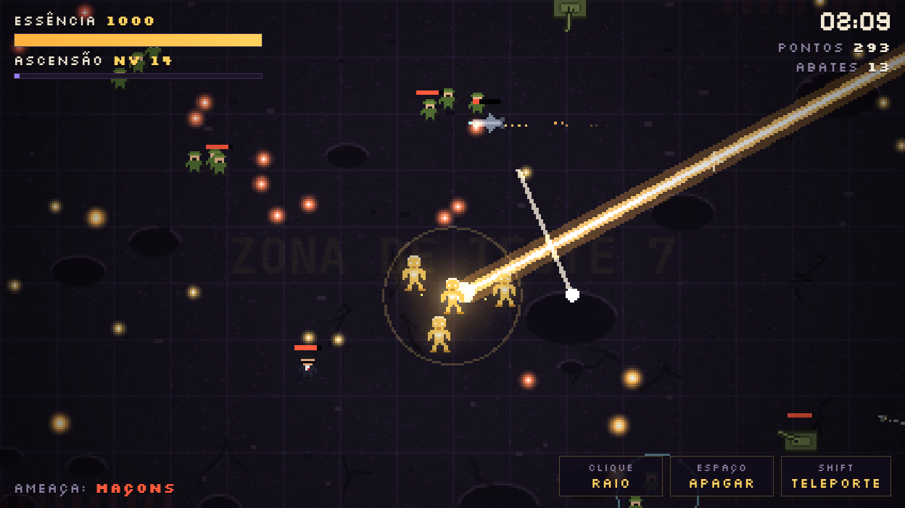
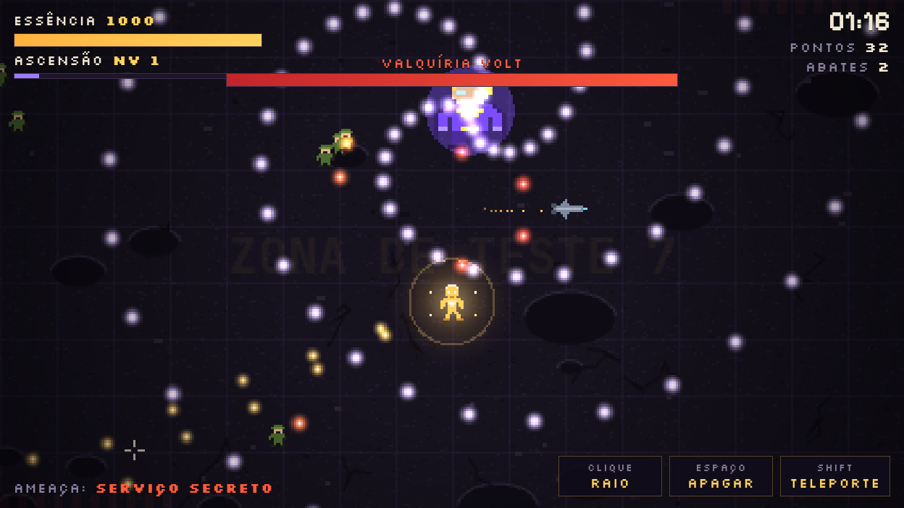
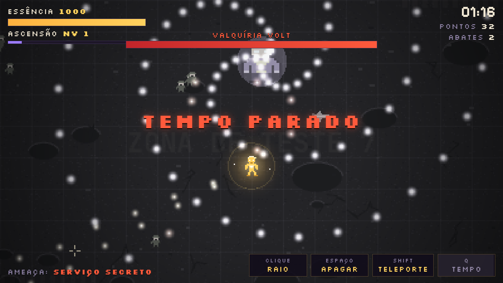
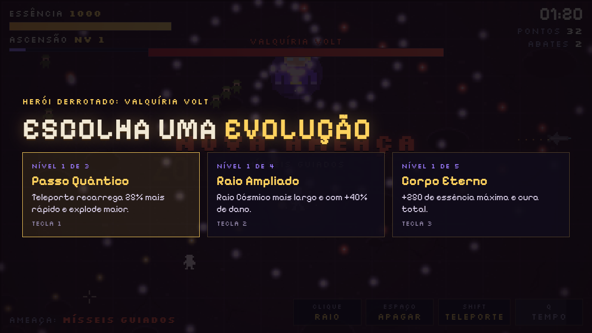
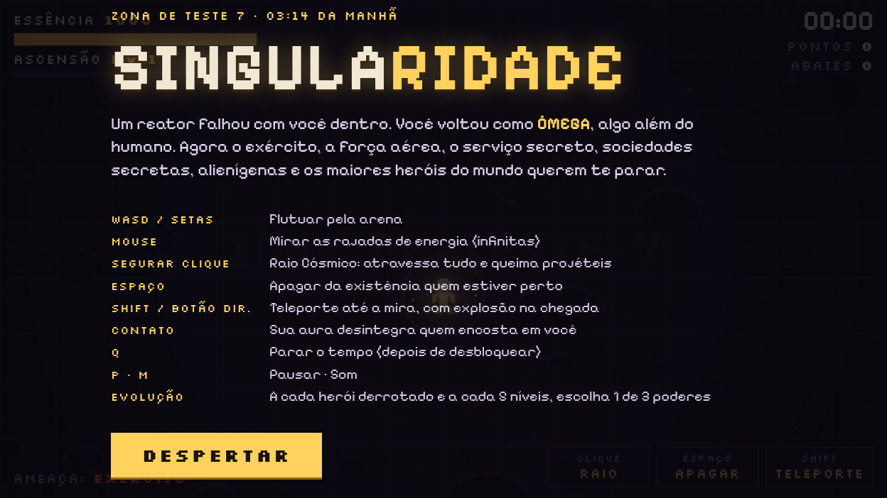
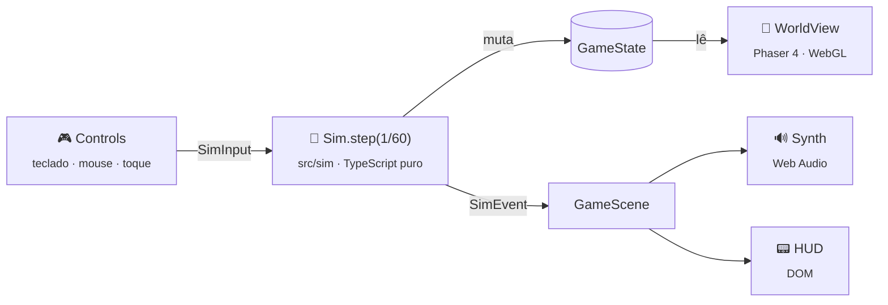

<div align="center">

# ✦ SINGULARIDADE ✦

**Bullet hell de sobrevivência em pixel art moderna, para navegador.**<br>
Você é **Ômega**. Seu poder é ilimitado. Sua vida, não.

[](https://phaser.io)
[](https://www.typescriptlang.org)
[](https://vite.dev)
[](#-arte-e-som-100-em-código)



[Jogar](#-como-rodar) · [Mecânicas](#-o-jogo) · [Arquitetura](#-arquitetura) · [Documentação](#-documentação) · [Roadmap](docs/10-changelog-e-roadmap.md)

</div>

---

> *Zona de Teste 7, 03:14 da manhã. Um reator experimental falha com um pesquisador dentro. O corpo dele se desfaz e se reconstrói como **Ômega**, uma consciência que manipula a matéria à vontade.*
>
> *O exército chega primeiro. Depois os blindados, a força aérea, o serviço secreto. Quando nada disso funciona, entram em cena sociedades secretas, alienígenas e os maiores super-heróis do mundo.*

## ⚡ O jogo

Ao contrário do bullet hell clássico, aqui você **não é frágil**: tem ataques infinitos, 1000 de essência, regeneração e poderes que apagam inimigos da existência. A tensão vem do **volume**. Inimigos, projéteis e o dano de cada golpe crescem sem teto até derrubar até um deus. Uma partida dura de 3 a 15 minutos, e o objetivo é bater o recorde.

<table>
<tr>
<td width="50%"></td>
<td width="50%"></td>
</tr>
<tr>
<td align="center"><sub><b>4 super-heróis originais</b> com padrões próprios e ciclos cada vez mais fortes</sub></td>
<td align="center"><sub><b>Parar o Tempo</b>: o mundo congela e perde a cor. Só Ômega se move</sub></td>
</tr>
<tr>
<td width="50%"></td>
<td width="50%"></td>
</tr>
<tr>
<td align="center"><sub><b>11 evoluções</b> sorteadas a cada herói derrotado e a cada 5 níveis</sub></td>
<td align="center"><sub>Desktop e <b>celular</b>, com joystick virtual e mira automática</sub></td>
</tr>
</table>

### Poderes

| | Poder | Efeito |
|:-:|---|---|
| 🔆 | **Rajadas de energia** | Automáticas e infinitas, ~12 disparos por segundo |
| 🌟 | **Raio Cósmico** | Feixe de 480 px que atravessa tudo e queima projéteis |
| ⚪ | **Apagar da existência** | Remove inimigos próximos sem deixar rastro. Vale pontos em dobro |
| 💫 | **Teleporte** | Salto até a mira, com explosão na chegada |
| 🔥 | **Aura de contato** | Desintegra quem chega perto |
| ⏸️ | **Parar o Tempo** · **Clones Quânticos** · **Chuva de Estrelas** · **Escudo de Fase** | Desbloqueáveis pelas evoluções |

### Ameaças

`Exército` → `Blindados` → `Força Aérea` → `Serviço Secreto` → `Mísseis guiados` → `Maçons` → `Invasão alienígena` → **`Tudo ao mesmo tempo`**

E a cada ~55 s, um herói: **Capitão Égide** · **Valquíria Volt** · **Titã Carmesim** · **Sentinela Estelar**.

<details>
<summary><b>🎮 Controles</b></summary>

<br>

| Desktop | | Celular | |
|---|---|---|---|
| `WASD` / setas | Flutuar | Arrastar à esquerda | Joystick virtual |
| Mouse | Mirar | | Mira automática |
| Segurar clique | Raio Cósmico | **RAIO** (segurar) | Raio Cósmico |
| `Espaço` | Apagar | **APAGAR** | Apagar |
| `Shift` / botão direito | Teleporte | **TELEPORTE** | Salto na direção do movimento |
| `Q` | Parar o Tempo | **PARAR TEMPO** | Parar o Tempo |
| `1` `2` `3` | Escolher evolução | Tocar na carta | Escolher evolução |
| `P` · `M` | Pausar · Som | | |

</details>

## 🚀 Como rodar

Requer **Node 22.18+**.

```bash
git clone https://github.com/Le-Jr/singularidade.git
cd singularidade
npm install
npm run dev          # → http://localhost:5173
```

| Comando | O que faz |
|---|---|
| `npm run dev` | Servidor de desenvolvimento com recarga automática |
| `npm run build` | Checa os tipos e gera `dist/`, pronto para qualquer hospedagem estática (itch.io, GitHub Pages, Netlify) |
| `npm run preview` | Serve o `dist/` localmente |
| `npm test` | Testes da simulação (Vitest) |
| `npm run sim -- 20` | Relatório de balanceamento: um bot joga 20 partidas com semente, sem navegador |
| `npm run playtest` | Com o `dev` rodando, joga no Chromium sem janela e salva capturas em `.playtest/` |

## 🧠 Arquitetura

A regra principal: **a lógica do jogo não conhece o Phaser.** Tudo o que decide o resultado de uma partida fica em `src/sim/`, em TypeScript puro, com timestep fixo de 60 Hz e sorteios com semente. A mesma semente com as mesmas entradas reproduz a mesma partida, e a simulação roda no Node para testes e balanceamento.



```
src/
├── main.ts          inicialização do Phaser e escala 16:9
├── scenes/          GameScene: fluxo da partida e loop de timestep fixo
├── sim/             regras do jogo, sem Phaser e sem DOM
│   └── data/        tabelas de inimigos, chefes e evoluções
├── render/          pixel art em código, texturas geradas, desenho do mundo
├── input/           teclado, mouse, joystick virtual, botões do celular
├── audio/           sintetizador de efeitos sonoros
└── ui/              HUD, telas e recorde
tests/               testes da simulação
tools/               balance.ts · playtest.ts
legacy/              a versão original em JavaScript puro, arquivo único
```

Os detalhes ficam em [docs/08-architecture.md](docs/08-architecture.md).

## 🎨 Arte e som 100% em código

O repositório não tem **nenhum** arquivo de imagem ou áudio do jogo. Cada sprite é uma grade de caracteres com paleta:

```ts
soldier: {
  rows: ['..gggg..', '.gGGGGg.', '..ssss..', '..skks..', '.gggggg.', /* … */],
  pal:  { g: '#4f6b2f', G: '#6d8b3c', s: '#e0b48a', k: '#22201c' },
},
```

As texturas (sprites, silhuetas de dano, projéteis com gradiente, chão, brilho, vinheta) são geradas na inicialização. Os sons são sintetizados em tempo real com osciladores e ruído filtrado da Web Audio API. A resolução interna é **400×225**, ampliada sem suavização, com brilho aditivo, centenas de partículas, tremor de tela e filtros de câmera.

## 📚 Documentação

| | Documento | Conteúdo |
|:-:|---|---|
| 🌌 | [Visão geral](docs/01-visao-geral.md) | Conceito, história, protagonista, loop de jogo |
| 🎮 | [Controles](docs/02-controles.md) | Teclado, mouse e celular |
| ⚡ | [Poderes](docs/03-poderes.md) | Poderes iniciais e desbloqueáveis, com números |
| 💀 | [Inimigos](docs/04-inimigos.md) | Os 7 tipos, atributos e padrões de tiro |
| 🦸 | [Chefes](docs/05-chefes.md) | Os 4 super-heróis e seus ataques |
| 🧬 | [Evoluções](docs/06-evolucoes.md) | As 11 cartas e builds sugeridas |
| 📈 | [Dificuldade e pontuação](docs/07-dificuldade-e-pontuacao.md) | Curvas de escala, ascensão, recorde |
| 🧠 | [Architecture](docs/08-architecture.md) | Código, loop, modelo de dados (em inglês) |
| 🎨 | [Arte e áudio](docs/09-arte-e-audio.md) | Direção visual, paleta, sprites e sons |
| 🗺️ | [Changelog e roadmap](docs/10-changelog-e-roadmap.md) | Versões e próximos passos |

## 🤖 Desenvolvendo com o Claude Code

O projeto traz skills em [`.claude/skills/`](.claude/skills) que o Claude Code carrega sozinho quando a tarefa pede:

| Skill | Para quê |
|---|---|
| `singularidade-dev` | Arquitetura, regras do código, diferenças do Phaser 4, como testar e quais docs atualizar |
| `game-content` | Receitas para criar inimigos, chefes, evoluções, poderes e fases de ameaça |
| `pixel-art-and-sfx` | Formato dos sprites, paleta, efeitos visuais e receitas de som |
| `balance-tuning` | Onde fica cada número da dificuldade e como medir mudanças com `npm run sim` |

---

<div align="center">
<sub>Fontes <a href="https://fonts.google.com/specimen/Pixelify+Sans">Pixelify Sans</a> e <a href="https://fonts.google.com/specimen/Silkscreen">Silkscreen</a> · Todos os personagens são originais</sub>
<br><br>
<b>Até deuses acabam.</b>
</div>
